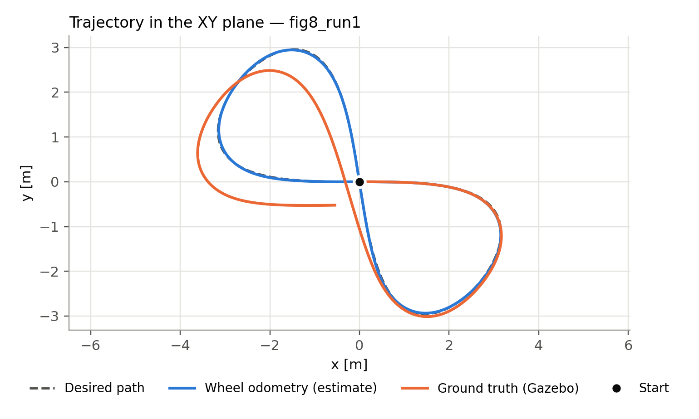
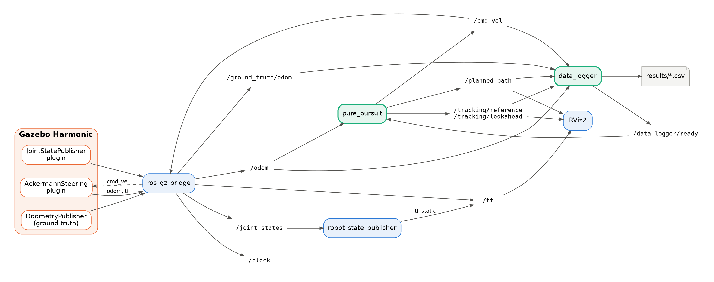

# Robot Ackermann — Simulación en ROS 2 Jazzy + Gazebo Harmonic

Robot móvil con dirección tipo **Ackermann** (tracción trasera y dirección delantera) que sigue una trayectoria en **figura en 8** mediante un controlador **Pure Pursuit**. El repositorio incluye el modelo URDF/Xacro, el mundo de Gazebo, el puente ROS↔Gazebo, el controlador, un nodo que registra los datos en CSV y los scripts que generan las gráficas de resultados.

**Integrantes:**
- `<Nombre integrante A>`: simulación y código
- `<Nombre integrante B>`: diseño CAD, planos y diapositivas
- `<Nombre integrante C>`: análisis teórico y documento IEEE



---

## 1. Requisitos

| Componente | Versión |
|---|---|
| Ubuntu | 24.04 LTS (Noble) |
| ROS 2 | Jazzy Jalisco |
| Gazebo | Harmonic (gz-sim 8), instalado con `ros-jazzy-ros-gz` |
| Python | 3.12 con `numpy` y `matplotlib` |

Si todavía no tienes ROS 2 Jazzy, sigue la [guía oficial de instalación](https://docs.ros.org/en/jazzy/Installation/Ubuntu-Install-Debs.html) (`ros-jazzy-desktop`). Después:

```bash
sudo apt update
sudo apt install -y ros-jazzy-ros-gz ros-jazzy-xacro ros-jazzy-robot-state-publisher \
  ros-jazzy-joint-state-publisher-gui ros-jazzy-teleop-twist-keyboard \
  python3-colcon-common-extensions python3-rosdep python3-numpy python3-matplotlib
```

## 2. Instalación y compilación

```bash
git clone <URL_DEL_REPOSITORIO> proyecto_R
cd proyecto_R
source /opt/ros/jazzy/setup.bash

# Dependencias declaradas en los package.xml
sudo rosdep init 2>/dev/null; rosdep update
rosdep install --from-paths src --ignore-src -r -y

# Compilación
colcon build --symlink-install
source install/setup.bash
```

> En cada terminal nueva hay que ejecutar `source /opt/ros/jazzy/setup.bash && source install/setup.bash` desde la carpeta del repo.

## 3. Ejecución

Todos los comandos se ejecutan **desde la raíz del repositorio**, porque los CSV se guardan en `./results`.

### 3.1 Todo en uno: simulación, controlador y registro

```bash
ros2 launch ackermann_controller run_all.launch.py
```

Se abren Gazebo y RViz2. A los ~8 s el robot recorre la figura en 8 (≈ 19.9 m a 0.5 m/s, ≈ 40 s), se detiene y el CSV queda en `results/run_<fecha>.csv`.

Argumentos útiles:

| Argumento | Por defecto | Descripción |
|---|---|---|
| `path_type` | `figure8` | `figure8`, `oval` o `custom` (waypoints del YAML) |
| `linear_speed` | `0.5` | velocidad lineal [m/s] |
| `lookahead_distance` | `0.6` | distancia look-ahead `Ld` [m] |
| `laps` | `1` | número de vueltas |
| `odom_topic` | `/odom` | `/ground_truth/odom` para realimentar con la pose real |
| `run_name` | fecha y hora | nombre del CSV |
| `headless` | `false` | `true` = Gazebo sin interfaz gráfica |
| `rviz` | `true` | abrir RViz2 |
| `use_meshes` | `false` | `true` = usar los STL del CAD |

Ejemplo: `ros2 launch ackermann_controller run_all.launch.py path_type:=oval laps:=2 run_name:=oval_1`

### 3.2 Por separado: simulación y controlador en dos terminales

```bash
# Terminal 1: Gazebo + robot + puente + RViz2
ros2 launch ackermann_gazebo sim.launch.py

# Terminal 2: Pure Pursuit + registro CSV
ros2 launch ackermann_controller controller.launch.py
```

### 3.3 Teleoperación manual (prueba del robot)

```bash
ros2 launch ackermann_gazebo sim.launch.py
# en otra terminal:
ros2 run teleop_twist_keyboard teleop_twist_keyboard
```

### 3.4 Ver solo el modelo URDF (sin Gazebo)

```bash
ros2 launch ackermann_description display.launch.py
```

### 3.5 Reproducir los experimentos y las gráficas

```bash
bash scripts/run_experiments.sh        # 3 corridas con odometría + 1 con pose real (headless)
python3 scripts/plot_results.py        # o regenerar solo las gráficas desde los CSV
```

## 4. Estructura del repositorio

```
proyecto_R/
├── src/
│   ├── ackermann_description/      # URDF/Xacro, meshes, RViz
│   │   ├── urdf/ackermann.urdf.xacro     # robot (parámetros de diseño)
│   │   ├── urdf/ackermann.gazebo.xacro   # plugins de Gazebo
│   │   ├── meshes/                       # STL exportados de Fusion 360
│   │   ├── launch/display.launch.py
│   │   └── rviz/{display,sim}.rviz
│   ├── ackermann_gazebo/           # mundo, puente y launch de simulación
│   │   ├── worlds/ackermann_world.sdf
│   │   ├── config/bridge.yaml
│   │   └── launch/sim.launch.py
│   └── ackermann_controller/       # nodos Python
│       ├── ackermann_controller/pure_pursuit_node.py
│       ├── ackermann_controller/data_logger_node.py
│       ├── ackermann_controller/paths.py     # figura en 8, óvalo, waypoints
│       ├── config/pure_pursuit.yaml          # velocidad, look-ahead y waypoints
│       └── launch/{controller,run_all}.launch.py
├── scripts/
│   ├── run_experiments.sh          # corre los experimentos (headless)
│   └── plot_results.py             # gráficas PNG + tabla de errores
├── results/                        # CSV, logs y results/plots/
└── docs/                           # diagrama de nodos y tópicos, guías
```

## 5. Parámetros del robot

| Parámetro | Símbolo | Valor |
|---|---|---|
| Distancia entre ejes | L | 0.30 m |
| Ancho de vía | W | 0.22 m |
| Radio de rueda | r | 0.05 m |
| Ancho de rueda | — | 0.03 m |
| Ángulo máximo de dirección | δmáx | 30° |
| Radio mínimo de giro | R = L / tan δmáx | 0.52 m |
| Chasis | — | 0.40 × 0.20 × 0.05 m, 2.0 kg |
| Masa de cada rueda | — | 0.2 kg |

El marco `base_link` está en el **punto medio del eje trasero**, a la altura de los ejes de las ruedas, con X hacia adelante y Z hacia arriba. Es el punto de referencia del modelo bicicleta y de Pure Pursuit.

## 6. Arquitectura: nodos y tópicos



| Tópico | Tipo | Origen → destino |
|---|---|---|
| `/cmd_vel` | `geometry_msgs/Twist` | pure_pursuit → Gazebo (AckermannSteering) |
| `/odom` | `nav_msgs/Odometry` | odometría de ruedas del plugin → controlador y logger |
| `/ground_truth/odom` | `nav_msgs/Odometry` | pose real del modelo (OdometryPublisher) → logger |
| `/tf`, `/tf_static` | `tf2_msgs/TFMessage` | `odom → base_link` (plugin), eslabones (robot_state_publisher) |
| `/joint_states` | `sensor_msgs/JointState` | Gazebo → robot_state_publisher |
| `/clock` | `rosgraph_msgs/Clock` | tiempo de simulación |
| `/planned_path` | `nav_msgs/Path` | ruta deseada (RViz y logger) |
| `/tracking/reference` | `geometry_msgs/PoseStamped` | pose deseada (punto más cercano de la ruta) |

## 7. Controlador Pure Pursuit

Con el robot en el eje trasero y un punto objetivo a una distancia `Ld` sobre la ruta:

- α = ángulo entre el rumbo del robot y la recta que lo une con el punto look-ahead
- δ = arctan(2 L sin α / Ld)  (saturado a ±30°)
- ω = v tan δ / L, que se publica en `/cmd_vel`. El plugin AckermannSteering lo convierte de vuelta a δ y reparte los ángulos de las ruedas izquierda y derecha según la condición de Ackermann.

El índice del punto más cercano solo avanza hacia adelante, así el robot no salta de tramo en el cruce de la figura en 8. Cerca de la meta la velocidad se reduce y al final se publica `/cmd_vel = 0`.

## 8. Resultados (figura en 8, v = 0.5 m/s, Ld = 0.6 m)

| Corrida | Realimentación | Error real máx. | Error real RMS | Error estimado RMS | Deriva final de la odometría | Deriva máx. de rumbo |
|---|---|---|---|---|---|---|
| fig8_run1 | odometría de ruedas | 71.5 cm | 36.1 cm | 1.2 cm | 68.6 cm (3.5 %) | 7.7° |
| fig8_run2 | odometría de ruedas | 71.4 cm | 36.1 cm | 1.2 cm | 68.6 cm | 7.6° |
| fig8_run3 | odometría de ruedas | 71.3 cm | 36.0 cm | 1.2 cm | 68.5 cm | 7.5° |
| fig8_gt | pose real (ground truth) | **2.5 cm** | **1.3 cm** | — | — | — |

- **Error real**: distancia de la pose real (Gazebo) a la ruta deseada.
- **Error estimado**: distancia de la pose de odometría a la ruta, es decir, lo que "ve" el controlador.

Pure Pursuit sigue la ruta con ~1 cm RMS respecto a la pose que tiene como entrada. El error real con odometría de ruedas viene casi por completo de la deriva de la odometría: el deslizamiento de las ruedas en las curvas acumula ~7.6° de error de rumbo. Fusionar la odometría con una IMU o GPS mediante un EKF (`robot_localization`) atacaría justo este problema.

Gráficas en [results/plots/](results/plots/), tabla completa en [results/plots/metrics.md](results/plots/metrics.md).

## 9. Cambiar al modelo CAD (Fusion 360 → URDF)

Ver [docs/cambiar_modelo_cad.md](docs/cambiar_modelo_cad.md).
